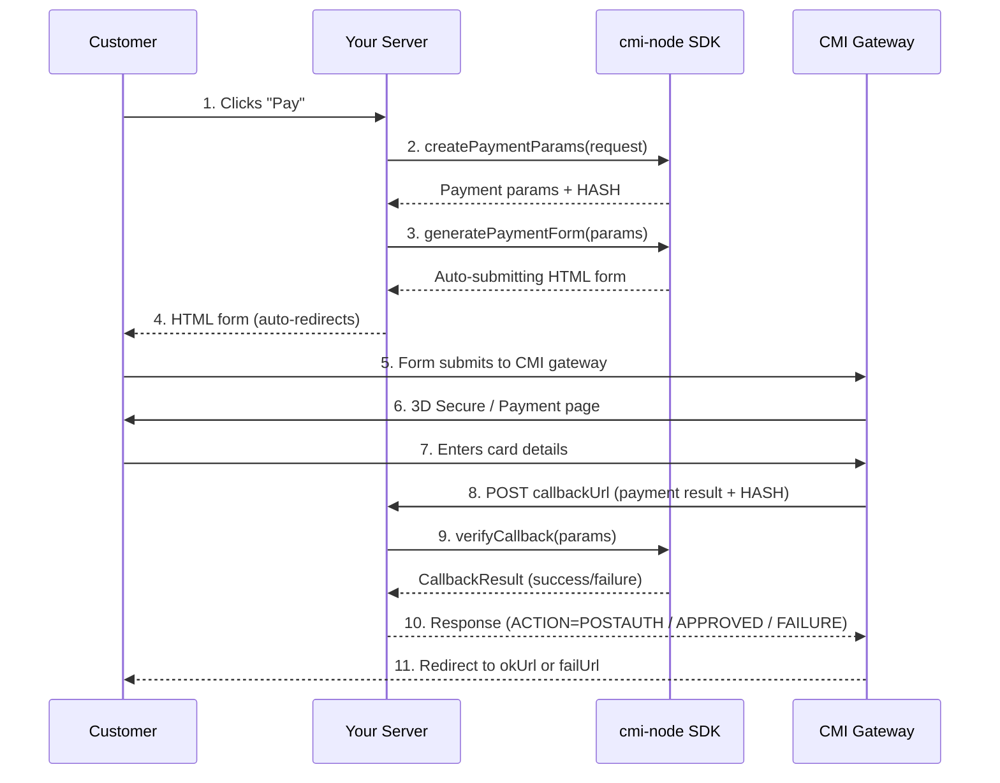

# cmi-node (Node.js Package)

[](https://www.npmjs.com/package/cmi-node)


[](https://opensource.org/licenses/MIT)

**Framework-agnostic CMI Payment Gateway SDK with built-in security for Node.js.**

The `cmi-node` package provides a seamless way to integrate the Centre Monétique Interbancaire (CMI) payment gateway into any Node.js application. It handles parameter building, hash generation, form generation, and callback verification with a focus on security and developer experience.

---

## 🚀 Features

- **Framework Agnostic**: Works with Express, NestJS, Next.js, Fastify, Hono, and more.
- **Type Safe**: Fully written in TypeScript with comprehensive type definitions.
- **Secure by Design**: Built-in hash verification (SHA-512) and timing-safe comparisons.
- **Flexible Callbacks**: Support for both `'auto'` and `'manual'` confirmation modes.
- **Middleware Helpers**: Pre-built helpers for popular frameworks to get you started in minutes.
- **No External Runtime Dependencies**: Uses only Node.js built-ins (`crypto`, `buffer`). Requires Node.js ≥ 22.12.
- **Server-only**: Importing the SDK into browser code fails immediately, so the `storeKey` can never be bundled into a web page.

---

## 🔄 Payment Flow



> **Note:** Step 8 (callback) only happens if `callbackUrl` is configured. Without it, payment confirmation must be done manually via the CMI Back Office.

---

## 📦 Installation

```bash
# Using npm
npm install cmi-node

# Using yarn (Classic or Berry)
yarn add cmi-node
```

> **Yarn Berry / PnP:** This package has zero runtime dependencies and correct `exports` maps, so it works out of the box with Yarn Berry's Plug'n'Play resolution. No special configuration is needed.

### Requirements

| | |
|---|---|
| Node.js | 22.12 or newer (Node 22, 24 and 26 are tested) |
| Runtime | Server only: API routes, route handlers, server actions, controllers. Importing `cmi-node` in browser code throws |
| Edge runtimes | Cloudflare Workers need the `nodejs_compat` compatibility flag (the SDK uses Node's `crypto` and `Buffer`). Vercel, Bun and Deno work as they are |
| TypeScript | Types included. Subpath types also resolve with `moduleResolution: "node"` (common in NestJS projects) |
| Frameworks (optional peers) | Express 4.17+ / 5, Fastify 4 / 5, Hono 4, Next.js 14–16, NestJS 10–12 |

### Upgrading from 1.x

Version 2.0 contains breaking changes. The full list is in [CHANGELOG.md](./CHANGELOG.md); the ones most likely to affect you:

- **Node.js 22.12 or newer** is required.
- **`gatewayUrl` and `callbackUrl` must use `https://`.** Plain `http://` is accepted only for `localhost`, `*.localhost`, `127.0.0.1` and `[::1]`.
- **`clientId` must contain digits only.**
- **Amounts with more than 2 decimals are rounded half-up to the cent**, as CMI does (`125.6578` → `125.66`). The old rounding was wrong for some values (`1.005` gave `"1.00"`, now `"1.01"`).
- **The logger prints only warnings and errors by default** outside production. Use `configureLogger({ level: 'debug' })` to see more.
- **The Next.js and Hono adapters no longer read callback data from the URL query string** unless `supportGetMethod` is enabled, and then only for GET requests.
- **Declined payments have their own status.** An authentic callback for a declined payment now returns `status: 'DECLINED'` with `verified: true` (it used to be `'FAILURE'`), and CMI is answered `APPROVED` as an acknowledgement, like CMI's reference `callback.php`. `'FAILURE'` now means a forged or invalid callback, or an order refused by `validateOrder`. See [`verifyCallback`](#gatewayverifycallbackcallbackparams).
- **The logger `sink` receives one string per call** (prefix, level, time, message and error stack), so pino and winston keep the whole message.

### Kits

The SDK is organised in kits, one per way of working with CMI:

| Kit | What it does | Import from |
|---|---|---|
| **Standard kit** | Redirects the customer to CMI's payment page with a signed form, and handles CMI's callback | `cmi-node/standard` |
| **API kit** | Back-office operations through CMI's XML API (capture, refund, void, order status) | coming in 2.1 |
| **Tokenization kit** | Payments with a registered card | coming soon |

`cmi-node` itself re-exports every kit, so `import { CMIPaymentGateway } from 'cmi-node'` works as well.

### Subpath Imports (Recommended)

For optimal bundle size, import framework adapters from their dedicated subpath:

```typescript
// Standard kit
import { CMIPaymentGateway } from 'cmi-node/standard';   // or from 'cmi-node'

// Framework adapters — import only what you need
import { createExpressMiddleware } from 'cmi-node/standard/express';   // or 'cmi-node/express'
import { createNextJsHandler, createNextJsAppRouterHandler, handleNextJsCallback } from 'cmi-node/standard/nextjs';
import { createFastifyHandler } from 'cmi-node/standard/fastify';
import { createHonoHandler } from 'cmi-node/standard/hono';
import { NestJSCallbackHandler } from 'cmi-node/standard/nestjs';
```

> **Note:** The shorter paths (`cmi-node/express`, `cmi-node/nextjs`, `cmi-node/fastify`, `cmi-node/hono`, `cmi-node/nestjs`) are the same files and keep working. All adapters are also re-exported from the main `'cmi-node'` entry, but subpath imports avoid loading adapters you don't need.

---

## 🛠️ Configuration

```typescript
import { CMIPaymentGateway } from 'cmi-node';

const gateway = new CMIPaymentGateway({
  storeKey: process.env.CMI_STORE_KEY!,    // Your CMI Store Key
  clientId: process.env.CMI_CLIENT_ID!,    // Your CMI Client ID
  gatewayUrl: 'https://testpayment.cmi.co.ma/fim/est3Dgate', // Gateway URL
  storetype: '3d_pay_hosting',
  trantype: 'PreAuth',
  callbackUrl: 'https://api.yoursite.com/payment/callback',
  confirmationMode: 'auto', // Optional: 'auto' | 'manual' (default: 'manual')
});
```

### `PaymentConfig`

| Field | Type | Required | Description |
|---|---|---|---|
| `storeKey` | `string` | ✅ | Secret key provided by CMI for hash generation. Read it from a server-side environment variable (see [Handling your storeKey safely](#-handling-your-storekey-safely)) |
| `clientId` | `string` | ✅ | Client ID provided by CMI (digits only) |
| `gatewayUrl` | `string` | ✅ | CMI gateway URL. Must use `https://` (plain `http://` only for localhost) |
| `storetype` | `string` | ✅ | Store type (`3d_pay_hosting`, `3d`, `pay_hosting`, etc.) |
| `trantype` | `string` | ✅ | Transaction type (case-insensitive: `preauth`, `auth`, `postauth`, `void`, `credit`) |
| `accountType` | `string` | ❌ | `'inshore'` (MAD only, the default) or `'offshore'` (foreign processing currency, no `amountCur` / `symbolCur`) |
| `callbackUrl` | `string` | ❌ | Callback URL for payment notifications. Must use `https://` (plain `http://` only for localhost). If omitted, payment confirmation will **not** be triggered automatically — the merchant must confirm manually via the CMI Back Office. |
| `confirmationMode` | `string` | ❌ | `'auto'` (ACTION=POSTAUTH) or `'manual'` (APPROVED). Default: `'manual'`. |

> The SDK strictly validates all configuration fields and rejects unknown or duplicate keys. Only the fields listed above are accepted. Check for typos if you see `"Unknown configuration field detected"`.

---

## 💻 Framework Examples

### 1. Express.js

```typescript
import express from 'express';
import { CMIPaymentGateway, createExpressMiddleware } from 'cmi-node';

const app = express();

// ⚠️ IMPORTANT: CMI posts the callback as application/x-www-form-urlencoded,
// so this parser MUST be registered before the callback route
app.use(express.json());
app.use(express.urlencoded({ extended: true }));

const gateway = new CMIPaymentGateway({
  storeKey: process.env.CMI_STORE_KEY!,
  clientId: process.env.CMI_CLIENT_ID!,
  gatewayUrl: 'https://testpayment.cmi.co.ma/fim/est3Dgate',
  storetype: '3d_pay_hosting',
  trantype: 'PreAuth',
  callbackUrl: 'https://api.yoursite.com/payment/callback',
  confirmationMode: 'auto',
});

// Initiate a payment — renders an auto-submitting HTML form
app.post('/pay', (req, res) => {
  const params = gateway.createPaymentParams({
    amount: 150.00,
    BillToName: 'Ishak Zail',
    email: 'ishak@example.com',
    tel: '+212600000000',
    okUrl: 'https://yoursite.com/success',
    failUrl: 'https://yoursite.com/failure',
    shopUrl: 'https://yoursite.com',
    currency: '504',   // MAD (required for inshore)
    lang: 'fr',        // 'fr' | 'en' | 'ar'
  });

  const form = gateway.generatePaymentForm(params);
  res.setHeader('Content-Type', 'text/html');
  res.send(form);
});

// Handle CMI callback — SDK verifies hash & sends response automatically
app.post('/payment/callback', createExpressMiddleware(gateway, {
  // ⚠️ IMPORTANT: runs BEFORE CMI is answered. Return false to answer FAILURE,
  // so CMI does not capture the payment. This is your amount check and your
  // replay protection: onSuccess runs only after CMI has been answered.
  validateOrder: async (result) => {
    const order = await db.orders.findOne({ id: result.orderData!.orderId });
    return !!order
      && order.status !== 'paid'                       // not already processed (replay)
      && order.amount === result.orderData!.amount;    // the amount you charged
  },
  // Runs after CMI has been answered: record the payment
  onSuccess: async (result) => {
    console.log('✅ Payment verified for order', result.orderData!.orderId);
    await db.orders.update(result.orderData!.orderId, {
      status: 'paid',
      transactionId: result.orderData!.transactionId,
    });
  },
  onFailure: (result) => {
    console.error('❌ Payment failed:', result.message, result.errorCode);
  },
}));

app.get('/success', (req, res) => res.send('Payment successful! Thank you.'));
app.get('/failure', (req, res) => res.send('Payment failed. Please try again.'));

app.listen(3000, () => console.log('Server running on http://localhost:3000'));
```

#### Express — Auto-register via Constructor

You can also pass the Express `app` directly to the constructor and it will auto-register the callback route:

```typescript
const app = express();
app.use(express.urlencoded({ extended: true }));

const gateway = new CMIPaymentGateway(
  {
    storeKey: process.env.CMI_STORE_KEY!,
    clientId: process.env.CMI_CLIENT_ID!,
    gatewayUrl: 'https://testpayment.cmi.co.ma/fim/est3Dgate',
    storetype: '3d_pay_hosting',
    trantype: 'PreAuth',
    callbackUrl: 'https://api.yoursite.com/payment/callback',
    confirmationMode: 'auto',
  },
  {
    app,                                      // Express app instance
    callbackPath: '/payment/callback',        // Default: '/api/payment/callback'
    callbackConfig: {
      validateOrder: async (result) => {
        const order = await db.orders.findOne({ id: result.orderData!.orderId });
        return !!order && order.status !== 'paid' && order.amount === result.orderData!.amount;
      },
      onSuccess: async (result) => {
        await db.orders.update(result.orderData!.orderId, { status: 'paid' });
      },
      onFailure: (result) => {
        console.error('Payment failed:', result.message);
      },
    },
  }
);
```

#### Express — Manual Callback Handler (Custom Response)

Use `createCallbackHandler` when you need full control over the response:

```typescript
import { createCallbackHandler } from 'cmi-node';

// Build the handler once, outside the route
const handler = createCallbackHandler(gateway, {
  autoRespond: false, // We'll handle the response manually
  validateOrder: async (result) => {
    const order = await db.orders.findOne({ id: result.orderData!.orderId });
    return !!order && order.status !== 'paid' && order.amount === result.orderData!.amount;
  },
  onSuccess: async (result) => {
    await updateOrder(result.orderData!.orderId, 'paid');
  },
});

app.post('/payment/callback', async (req, res) => {
  const result = await handler.handle(req.body);

  // getResponse() gives the answer CMI expects: ACTION=POSTAUTH or APPROVED for an
  // approved payment (depending on confirmationMode), APPROVED for an authentic
  // declined payment, and FAILURE for a forged or refused callback.
  const answer = handler.getResponse(result);
  res.status(answer.status).type('text/plain').send(answer.body);
});
```

---

### 2. NestJS

```typescript
// ──────────────────────────────────────────────
// /cmi/payment.module.ts
// ──────────────────────────────────────────────
import { Module } from '@nestjs/common';
import { ConfigModule } from '@nestjs/config';
import { PaymentController } from './payment.controller';
import { PaymentService } from './payment.service';

@Module({
  imports: [ConfigModule],
  controllers: [PaymentController],
  providers: [PaymentService],
})
export class PaymentModule {}

// ──────────────────────────────────────────────
// /cmi/payment.service.ts
// ──────────────────────────────────────────────
import { Injectable } from '@nestjs/common';
import { ConfigService } from '@nestjs/config';
import { CMIPaymentGateway, NestJSCallbackHandler } from 'cmi-node';

@Injectable()
export class PaymentService {
  public readonly gateway: CMIPaymentGateway;
  public readonly callbackHandler: NestJSCallbackHandler;

  constructor(private config: ConfigService) {
    this.gateway = new CMIPaymentGateway({
      storeKey: this.config.getOrThrow('CMI_STORE_KEY'),
      clientId: this.config.getOrThrow('CMI_CLIENT_ID'),
      gatewayUrl: 'https://testpayment.cmi.co.ma/fim/est3Dgate',
      storetype: '3d_pay_hosting',
      trantype: 'PreAuth',
      callbackUrl: this.config.getOrThrow('CMI_CALLBACK_URL'),
      confirmationMode: 'auto',
    });

    this.callbackHandler = new NestJSCallbackHandler(this.gateway, {
      // Runs BEFORE CMI is answered: return false to refuse the payment (FAILURE).
      // Check the order exists, is not already paid (replay) and the amount matches.
      validateOrder: async (result) => {
        const order = await db.orders.findOne({ id: result.orderData!.orderId });
        return !!order && order.status !== 'paid' && order.amount === result.orderData!.amount;
      },
      onSuccess: async (result) => {
        console.log('✅ Payment verified for order', result.orderData?.orderId);
        // await this.ordersService.markAsPaid(result.orderData?.orderId);
      },
      onFailure: async (result) => {
        console.error('❌ Payment failed:', result.message);
      },
    });
  }
}

// ──────────────────────────────────────────────
// /cmi/payment.controller.ts
// ──────────────────────────────────────────────
import { Controller, Get, Post, Query, Body, Res } from '@nestjs/common';
import type { Response } from 'express';
import { PaymentService } from './payment.service';

@Controller('payment')
export class PaymentController {
  constructor(private readonly paymentService: PaymentService) {}

  @Post('/pay')
  pay(@Body('amount') amount: string, @Res() res: Response) {
    const params = this.paymentService.gateway.createPaymentParams({
      amount: parseFloat(amount) || 100,
      BillToName: 'Adil Essakhi',
      email: 'adil@example.com',
      okUrl: 'https://yoursite.com/success',
      failUrl: 'https://yoursite.com/failure',
      shopUrl: 'https://yoursite.com',
      currency: '504',
      lang: 'fr',
    });

    const form = this.paymentService.gateway.generatePaymentForm(params);
    res.setHeader('Content-Type', 'text/html');
    return res.send(form);
  }

  @Post('callback')
  async handleCallback(@Body() body: any, @Res() res: Response) {
    return this.paymentService.callbackHandler.handle(body, res);
  }
}
```

#### NestJS — Function-style Handler

```typescript
import { createNestJSHandler } from 'cmi-node';

const handleCallback = createNestJSHandler(gateway, {
  // Runs before CMI is answered: check the order, its amount and that it is not already paid
  validateOrder: async (result) => {
    const order = await db.orders.findOne({ id: result.orderData!.orderId });
    return !!order && order.status !== 'paid' && order.amount === result.orderData!.amount;
  },
  onSuccess: async (result) => {
    // await updateOrder(result.orderData?.orderId);
  },
});

@Post('callback')
async callback(@Body() body: any, @Res() res: Response) {
  return handleCallback(body, res);
}
```


#### NestJS — Add your newly created module to your app module
```typescript
// app.module.ts
import { Module } from '@nestjs/common';
import { AppController } from './app.controller';
import { AppService } from './app.service';
import { PaymentModule } from './cmi/payment.module';
import { ConfigModule } from '@nestjs/config';

@Module({
  imports: [ConfigModule.forRoot(), PaymentModule],
  controllers: [AppController],
  providers: [AppService],
})
export class AppModule {}

```

---

### 3. Next.js — Pages Router

```typescript
// lib/cmi-gateway-config.ts

import { CMIPaymentGateway } from 'cmi-node';

export const gateway = new CMIPaymentGateway({
  storeKey: process.env.CMI_STORE_KEY!,
  clientId: process.env.CMI_CLIENT_ID!,
  gatewayUrl: 'https://testpayment.cmi.co.ma/fim/est3Dgate',
  storetype: '3d_pay_hosting',
  trantype: 'PreAuth',
  callbackUrl: 'https://yoursite.com/api/payment/callback',
  confirmationMode: 'auto',
});

// pages/api/payment/pay.ts

import type { NextApiRequest, NextApiResponse } from 'next';
import { gateway } from '../../../lib/cmi-gateway-config';

export default async function handler(
  req: NextApiRequest,
  res: NextApiResponse,
) {
  if (req.method !== 'POST') {
    return res.status(405).json({ error: 'Method Not Allowed' });
  }

  try {
    const params = gateway.createPaymentParams({
      amount: req.body.amount || '300',
      BillToName: req.body.BillToName || 'CMI user',
      email: req.body.email || 'user@example.com',
      tel: req.body.tel || '0606060606',
      okUrl: 'https://yoursite.com/success',
      failUrl: 'https://yoursite.com/failure',
      shopUrl: 'https://yoursite.com',
      currency: req.body.currency || 'MAD',
      lang: req.body.lang || 'en',
    });

    const form = gateway.generatePaymentForm(params);

    res.setHeader('Content-Type', 'text/html');
    return res.status(200).send(form);
  } catch (error) {
    return res.status(500).json({
      error: 'Payment processing failed',
      message: error instanceof Error ? error.message : 'Unknown error',
    });
  }
}

// pages/api/payment/callback.ts

import { createNextJsHandler } from 'cmi-node';
import { gateway } from '../../../lib/cmi-gateway-config';

// Next.js parses the form-encoded CMI callback for API routes by default.
export default createNextJsHandler(gateway, {
  // Runs before CMI is answered: return false to refuse the payment
  validateOrder: async (result) => {
    const order = await db.orders.findOne({ id: result.orderData!.orderId });
    return !!order && order.status !== 'paid' && order.amount === result.orderData!.amount;
  },
  onSuccess: async (result) => {
    await db.orders.update(result.orderData!.orderId, { status: 'paid' });
  },
  onFailure: async (result) => {
    console.error('Payment failed:', result.message);
  },
});
```

### 3. Next.js — App Router

```typescript
// app/lib/cmi-gateway-config.ts  (server-only module)

import { CMIPaymentGateway } from 'cmi-node';

export const gateway = new CMIPaymentGateway({
  storeKey: process.env.CMI_STORE_KEY!,
  clientId: process.env.CMI_CLIENT_ID!,
  gatewayUrl: 'https://testpayment.cmi.co.ma/fim/est3Dgate',
  storetype: '3d_pay_hosting',
  trantype: 'PreAuth',
  callbackUrl: 'https://yoursite.com/api/payment/callback',
  confirmationMode: 'auto',
});

// app/api/payment/pay/route.ts
import { NextRequest, NextResponse } from 'next/server';
import { gateway } from '../../../lib/cmi-gateway-config';

export async function POST(_request: NextRequest) {
  try {

    const params = gateway.createPaymentParams({
      amount: '300',
      BillToName: 'CMI user',
      email: 'user@example.com',
      tel: '0606060606',
      okUrl: "https://yoursite.com/success",
      failUrl: "https://yoursite.com/failure",
      shopUrl: "https://yoursite.com",
      currency: 'MAD',
      lang: 'en',
    });
    const form = gateway.generatePaymentForm(params);

    return new NextResponse(form, {
      status: 200,
      headers: { "Content-Type": "text/html" },
    });
  } catch (error) {
    return NextResponse.json(
      {
        error: "Payment processing failed",
        message: error instanceof Error ? error.message : "Unknown error",
      },
      { status: 500 },
    );
  }
}

// app/api/payment/callback/route.ts
import { createNextJsAppRouterHandler } from 'cmi-node/nextjs';
import { gateway } from '../../../lib/cmi-gateway-config';

// Built once, reused for every callback request
export const POST = createNextJsAppRouterHandler(gateway, {
  // Runs before CMI is answered: return false to refuse the payment
  validateOrder: async (result) => {
    const order = await db.orders.findOne(result.orderData!.orderId);
    return !!order && order.status !== 'paid' && order.amount === result.orderData!.amount;
  },
  onSuccess: async (result) => {
    await db.orders.markPaid(result.orderData!.orderId, result.orderData!.transactionId);
  },
  onFailure: async (result) => {
    console.error('Payment failed:', result.message);
  },
});
```

> `handleNextJsCallback(gateway, request, options)` still works and does the same thing, but builds a new handler on every request.

---

### 4. Fastify

CMI posts the callback as `application/x-www-form-urlencoded`, which Fastify does not parse on its own: install and register `@fastify/formbody`, or the callback is rejected with HTTP 415.

```bash
npm install @fastify/formbody
```

```typescript
import Fastify from 'fastify';
import formbody from '@fastify/formbody';
import { CMIPaymentGateway, createFastifyHandler } from 'cmi-node';

const fastify = Fastify();

// ⚠️ IMPORTANT: parses CMI's form-encoded callback
await fastify.register(formbody);

const gateway = new CMIPaymentGateway({
  storeKey: process.env.CMI_STORE_KEY!,
  clientId: process.env.CMI_CLIENT_ID!,
  gatewayUrl: 'https://testpayment.cmi.co.ma/fim/est3Dgate',
  storetype: '3d_pay_hosting',
  trantype: 'PreAuth',
  callbackUrl: 'https://yoursite.com/cmi/callback',
  confirmationMode: 'auto',
});

// Initiate payment
fastify.post('/cmi/pay', async (request, reply) => {
  const params = gateway.createPaymentParams({
    amount: 200,
    BillToName: 'Ishak Zail',
    email: 'ishak@example.com',
    okUrl: 'https://yoursite.com/success',
    failUrl: 'https://yoursite.com/failure',
    shopUrl: 'https://yoursite.com',
    currency: '504',
  });
  return reply.type('text/html').send(gateway.generatePaymentForm(params));
});

// Handle the CMI callback
fastify.post('/cmi/callback', createFastifyHandler(gateway, {
  // Runs before CMI is answered: return false to refuse the payment
  validateOrder: async (result) => {
    const order = await db.orders.findOne({ id: result.orderData!.orderId });
    return !!order && order.status !== 'paid' && order.amount === result.orderData!.amount;
  },
  onSuccess: async (result) => {
    await db.orders.update(result.orderData!.orderId, { status: 'paid' });
  },
  onFailure: (result) => {
    console.error('Payment failed:', result.message);
  },
}));

fastify.listen({ port: 3000, host: '0.0.0.0' }, (err, address) => {
  if (err) throw err;
  console.log(`Server running at ${address}`);
});
```

Instead of `fastify.post(...)`, you can let the SDK register the route (use one or the other, not both: Fastify refuses two handlers for the same route):

```typescript
import { registerFastifyCallback } from 'cmi-node';

registerFastifyCallback(fastify, gateway, {
  path: '/cmi/callback',            // Default: '/api/payment/callback'
  validateOrder: async (result) => {
    const order = await db.orders.findOne({ id: result.orderData!.orderId });
    return !!order && order.status !== 'paid' && order.amount === result.orderData!.amount;
  },
  onSuccess: async (result) => {
    await db.orders.update(result.orderData!.orderId, { status: 'paid' });
  },
});
```

---

### 5. Hono

```typescript
import { serve } from '@hono/node-server'
import 'dotenv/config'
import { Hono } from 'hono'
import { CMIPaymentGateway, createHonoHandler } from 'cmi-node';

const app = new Hono()

const gateway = new CMIPaymentGateway({
  storeKey: process.env.CMI_STORE_KEY!,
  clientId: process.env.CMI_CLIENT_ID!,
  gatewayUrl: 'https://testpayment.cmi.co.ma/fim/est3Dgate',
  storetype: '3d_pay_hosting',
  trantype: 'PreAuth',
  callbackUrl: 'https://yoursite.com/cmi/callback',
  confirmationMode: 'auto',
});

// Initiate payment
app.post('/pay', (c) => {
  try {
    const params = gateway.createPaymentParams({
      amount: 300,
      BillToName: 'Jhon  doe',
      email: 'Jhon@example.com',
      okUrl: 'https://yoursite.com/success',
      failUrl: 'https://yoursite.com/failure',
      shopUrl: 'https://yoursite.com',
      currency: '504',
    });

    const form = gateway.generatePaymentForm(params);
    return c.html(form);
  } catch (error) {

    c.status(500);
    return c.json({
      error: 'Failed to create payment form',
      message: error instanceof Error ? error.message : 'Unknown error',
    });
  }
});

// Handle the CMI callback (the adapter reads the form-encoded body itself)
app.post('/cmi/callback', createHonoHandler(gateway, {
  // Runs before CMI is answered: return false to refuse the payment
  validateOrder: async (result) => {
    const order = await db.orders.findOne({ id: result.orderData!.orderId });
    return !!order && order.status !== 'paid' && order.amount === result.orderData!.amount;
  },
  onSuccess: async (result) => {
    await db.orders.update(result.orderData!.orderId, { status: 'paid' });
  },
}));

serve({
  fetch: app.fetch,
  port: 3000
}, (info) => {
  console.log(`Server is running on http://localhost:${info.port}`)
})

```

Instead of `app.post(...)`, you can let the SDK register the route (use one or the other, not both):

```typescript
import { registerHonoCallback } from 'cmi-node';

registerHonoCallback(app, gateway, {
  path: '/cmi/callback',            // Default: '/api/payment/callback'
  validateOrder: async (result) => {
    const order = await db.orders.findOne({ id: result.orderData!.orderId });
    return !!order && order.status !== 'paid' && order.amount === result.orderData!.amount;
  },
  onSuccess: async (result) => {
    await db.orders.update(result.orderData!.orderId, { status: 'paid' });
  },
});
```

---

## 📖 API Reference

### `CMIPaymentGateway`

The main class for interacting with the CMI payment gateway.

#### Constructor

```typescript
new CMIPaymentGateway(config: PaymentConfig, options?: {
  app?: any;                   // Express app for auto-registration
  callbackPath?: string;       // Default: '/api/payment/callback'
  callbackConfig?: CallbackHandlerOptions;
})
```

Pass an Express `app` in the second argument to auto-register the callback endpoint. For all other frameworks, use the dedicated helpers.

---

### `gateway.createPaymentParams(request)`

Creates payment parameters for initiating a payment. Returns a `PaymentParams` object (exactly what is posted to CMI, including `hash`) ready to pass to `generatePaymentForm()`.

#### `PaymentRequest`

| Field | Type | Required | Max Length | Description |
|---|---|---|---|---|
| `amount` | `number \| string` | ✅ | — | Payment amount (≥ 1). More than 2 decimals are rounded half-up to the cent, as CMI does (`125.6578` → `125.66`) |
| `email` | `string` | ✅ | 64 | Customer email address |
| `BillToName` | `string` | ✅ | 255 | Customer billing name (alphanumeric + spaces) |
| `okUrl` | `string` | ✅ | — | Redirect URL on success (must use `http(s)://`) |
| `failUrl` | `string` | ✅ | — | Redirect URL on failure (must use `http(s)://`) |
| `shopUrl` | `string` | ✅ | — | Your shop URL (must use `http(s)://`) |
| `currency` | `string` | ✅ | — | Currency code or numeric. Must be `"504"` or `"MAD"`.|
| `currency` | `string` | ✅ | — | Currency code or numeric. Must be `"504"` or `"MAD"`.|
| `oid` | `string` | ❌ | 64 | Order ID (auto-generated if omitted) |
| `rnd` | `string` | ❌ | 20 | Random value (auto-generated if omitted, must be alphabetic) |
| `lang` | `string` | ❌ | — | Language code: `"fr"`, `"en"`, `"ar"`, etc. (default: `"fr"`) |
| `tel` | `string` | ❌ | 32 | Customer phone number |
| `description` | `string` | ❌ | 125 | Payment description |
| `AutoRedirect` | `boolean` | ❌ | — | Auto-redirect after payment (default: `false`) |
| `hashAlgorithm` | `string` | ❌ | — | Must be `"ver3"` if provided |
| `encoding` | `string` | ❌ | — | Must be `"UTF-8"` if provided (default: `"UTF-8"`) |
| `amountCur` | `number` | ❌ | — | Display amount in foreign currency (requires `symbolCur`) |
| `symbolCur` | `string` | ❌ | — | Foreign currency code, e.g. `"840"` for USD (requires `amountCur`) |
| `amountCur` | `number` | ❌ | — | Display amount in foreign currency (requires `symbolCur`) |
| `symbolCur` | `string` | ❌ | — | Foreign currency code, e.g. `"840"` for USD (requires `amountCur`) |
| `sessiontimeout` | `number` | ❌ | — | CMI hosted page session timeout in seconds. Min: 30, Max: 2700, Default: 1800. |
| `redirectGet` | `boolean` | ❌ | — | When `true`, CMI redirects the customer to `okUrl`/`failUrl` via GET instead of POST. |
| `CallbackResponse` | `boolean` | ❌ | — | Enables or disables the server-to-server callback for this specific request. Default: `true`. |
| `BillToCompany` | `string` | ❌ | 255 | Billing company name |
| `BillToStreet1` | `string` | ❌ | 255 | Billing street address line 1 |
| `BillToStreet2` | `string` | ❌ | 255 | Billing street address line 2 |
| `BillToStreet3` | `string` | ❌ | 255 | Billing street address line 3 |
| `BillToCity` | `string` | ❌ | 64 | Billing city |
| `BillToStateProv` | `string` | ❌ | 32 | Billing state/province |
| `BillToPostalCode` | `string` | ❌ | 32 | Billing postal code |
| `BillToCountry` | `string` | ❌ | 3 | Billing country code |
| `BillToTelVoice` | `string` | ❌ | — | Billing telephone (voice) |

> **Custom fields:** Any field not listed above is passed through to the gateway as-is. Field names are case-insensitive — `shopUrl`, `SHOPURL`, and `shopurl` all resolve to the same field.

> **Accents and non-Latin text:** like CMI's reference PHP script, the SDK cleans `BillToName`, `BillToCompany`, `BillToStreet1`, `BillToCity`, `BillToStateProv`, `BillToPostalCode` and `BillToCountry`. Accents are removed (`Zoé Lahlou` → `Zoe Lahlou`), and characters other than `a-z A-Z 0-9 _ - space` are dropped, including Arabic letters. A `BillToName` written only in Arabic is therefore rejected; an optional field that ends up empty is not sent. Other fields, such as `description` and custom fields, are sent in UTF-8 unchanged.

#### Item-Level Fields

CMI supports per-item order details using numbered field names. Pass them as additional properties on the request:

```typescript
gateway.createPaymentParams({
  amount: 29.98,
  currency: '504',
  // ...other required fields
  id1: 'ITEM-001',
  itemnumber1: '1',
  productcode1: 'BOOK',
  qty1: 2,
  desc1: 'Node.js Book',
  price1: 14.99,
  total1: 29.98,
});
```

---

### `gateway.generatePaymentForm(params, options?)`

Generates a fully styled, auto-submitting HTML page that redirects the customer to the CMI gateway. The page includes a loading overlay with a spinner and "Secured by CMI" badge displayed during the redirect.

```typescript
const form = gateway.generatePaymentForm(params);
res.setHeader('Content-Type', 'text/html');
res.send(form);
```

**Options:**

| Field | Type | Description |
|---|---|---|
| `nonce` | `string` | CSP nonce applied to inline `<style>` and `<script>` tags |

#### Strict Content-Security-Policy

The generated page uses an inline `<style>` and `<script>`. If your CSP blocks `'unsafe-inline'`, either pass your nonce:

```typescript
const form = gateway.generatePaymentForm(params, { nonce: req.cspNonce });
res.send(form);
```

or build your own form from the escaped hidden inputs returned by `generatePaymentInputs()`:

```typescript
const inputs = gateway.generatePaymentInputs(params); // string[] of <input type="hidden" ...>

res.send(`
  <form method="POST" action="https://testpayment.cmi.co.ma/fim/est3Dgate">
    ${inputs.join('\n')}
    <button type="submit">Continue to payment</button>
  </form>
`);
```

### `gateway.generatePaymentInputs(params)`

Returns one HTML-escaped `<input type="hidden">` string per payment parameter (including `hash`), for custom forms. The values are exactly the ones `generatePaymentForm()` would post.

---

### `gateway.verifyCallback(callbackParams)`

Verifies a raw callback from the CMI gateway using a timing-safe SHA-512 hash comparison.

```typescript
const result = gateway.verifyCallback(req.body);
if (result.success) {
  // Authentic, approved payment — check the order (amount, not already paid), then record it
} else if (result.verified) {
  // Authentic callback for a declined payment (status 'DECLINED'): mark the attempt as failed
} else {
  // Forged, altered or unsigned callback (status 'FAILURE'): ignore it
}
```

The three kinds of callback, and what the SDK answers CMI:

| Callback | `success` | `verified` | `status` | Answer sent to CMI |
|---|---|---|---|---|
| Authentic, approved payment (`ProcReturnCode` `00`) | `true` | `true` | `'ACTION=POSTAUTH'` (`auto`) or `'APPROVED'` (`manual`) | the same as `status` |
| Authentic, declined payment (any other `ProcReturnCode`) | `false` | `true` | `'DECLINED'` | `APPROVED`, an acknowledgement as in CMI's reference `callback.php` (change it with `declinedResponse`) |
| Missing or wrong `HASH`, or a technical error | `false` | `false` | `'FAILURE'` | `FAILURE` |
| Approved payment refused by your `validateOrder` | `false` | `true` | `'FAILURE'` | `FAILURE` (CMI does not capture) |

`onFailure` runs for the last three rows: use `result.verified` to tell a real decline from a forged callback.

#### `CallbackResult`

```typescript
interface CallbackResult {
  /** True only for an authentic, approved payment (ProcReturnCode "00"). */
  success: boolean;
  status: 'ACTION=POSTAUTH' | 'APPROVED' | 'DECLINED' | 'FAILURE';
  /** True when the HASH matched, i.e. the data really comes from CMI. */
  verified: boolean;
  message: string;
  orderData?: {
    // ── Core fields ───────────────────────────────────────────────
    orderId: string | undefined;
    amount: number;
    currency: string;
    /** Bank transaction ID. From TransId. Undefined on failure callbacks. */
    transactionId?: string;

    // ── Always present (success + failure) ───────────────────────
    /** Bank/gateway return code. '00' = success. From ProcReturnCode. */
    returnCode?: string;
    /** Human-readable label, e.g. "Approved", "Error", "Declined". From Response. */
    response?: string;
    /** 3D-Secure authentication status. 1 = full 3D, 0 = failed. From mdStatus. */
    mdStatus?: string;
    /** Error description. From ErrMsg. */
    errorMessage?: string;
    /** Error code, e.g. "CORE-5110". From ErrCode. */
    errorCode?: string;
    /** Order ID echoed back by CMI. From ReturnOid. */
    returnOid?: string;
    /** Cardholder IP address. From ClientIp. */
    clientIp?: string;

    // ── Present on success ─────────────────────────────────────────
    /** Bank authorisation code. From AuthCode. */
    authCode?: string;
    /** Transaction date/time as ddmmyyyy hhmmss. From EXTRA.TRXDATE. */
    transactionDate?: string;
    /** Masked card number, e.g. "400000XXXXXX7190". From MaskedPan. */
    maskedPan?: string;
    /** Cardholder full name. From cardHolderName. */
    cardHolderName?: string;
    /** Payment method type, e.g. "CARD". From paymentType. */
    paymentType?: string;
    /** Card scheme, e.g. "VISA", "MASTERCARD". From EXTRA.CARDBRAND. */
    cardBrand?: string;
    /** Card-issuing bank name. From EXTRA.CARDISSUER. */
    cardIssuer?: string;
    /** Card expiry year. From EcomPaymentCardExpDateYear. */
    cardExpYear?: string;
    /** Card expiry month. From EcomPaymentCardExpDateMonth. */
    cardExpMonth?: string;
    /** Host reference number assigned by acquirer. From HostRefNum. */
    hostRefNum?: string;
    /** Acquirer STAN (System Trace Audit Number). From acqStan. */
    acqStan?: string;
    /** Electronic Commerce Indicator. From eci. */
    eci?: string;
    /** 3D archival status: Y / N / A. From txstatus. */
    txStatus?: string;
  };
  errorCode?: string;
  errorMessage?: string;
}
```

---

### `gateway.getConfirmationMode()`

Returns the current confirmation mode (`'auto'` or `'manual'`).

### `gateway.getConfig()`

Returns the gateway configuration **without** the `storeKey` (sanitized for safety).

---

### `CallbackHandler`

The low-level handler class used internally by all framework helpers. Use it when you need fine-grained control over callback processing.

```typescript
import { CallbackHandler } from 'cmi-node';

const handler = new CallbackHandler(gateway, {
  autoRespond: false,
  onSuccess: async (result) => { /* ... */ },
  onFailure: async (result) => { /* ... */ },
});

// In your route:
const result = await handler.handle(req.body);
const response = handler.getResponse(result);
res.status(response.status).send(response.body);
```

#### `CallbackHandlerOptions`

| Field | Type | Default | Description |
|---|---|---|---|
| `validateOrder` | `(result: CallbackResult) => boolean \| Promise<boolean>` | — | Runs **before** CMI is answered, for authentic approved payments only. Return `false` (or throw) to answer `FAILURE`, so CMI does not capture. Use it to check that the order exists, matches the amount and is not already paid (this is also your replay protection). The SDK warns once if `confirmationMode` is `'auto'` and this is missing |
| `onSuccess` | `(result: CallbackResult) => void \| Promise<void>` | — | Called when payment is verified successfully |
| `onFailure` | `(result: CallbackResult) => void \| Promise<void>` | — | Called when payment verification fails |
| `autoRespond` | `boolean` | `true` | Automatically send the appropriate response string to CMI |
| `successResponse` | `string` | `"ACTION=POSTAUTH"` or `"APPROVED"` | Custom success response message |
| `failureResponse` | `string` | `"FAILURE"` | Custom failure response message (also sent with status 500 when handling throws) |
| `declinedResponse` | `string` | `"APPROVED"` | Answer for an authentic callback of a declined payment (CMI expects an acknowledgement) |
| `supportGetMethod` | `boolean` | `false` | Accept callback params from GET query strings ⚠️ |

The Express, Fastify, Next.js Pages and NestJS helpers answer CMI first, then run `onSuccess` / `onFailure`, so a slow callback cannot delay CMI's answer. The Hono and Next.js App Router helpers return a `Response`, so they run the callbacks before answering: keep them fast there.

For your own adapter, `handler.evaluate(params)` returns `{ result, response }` without running the callbacks, `handler.notify(result)` runs them, and `handler.errorResponse()` gives the answer to send when something throws.

> ⚠️ **Security Warning:** Enabling `supportGetMethod` causes callback parameters (including `HASH` and payment data) to be read from query strings. Query strings are logged in server access logs, browser history, proxy caches, and CDN logs. Only enable this if your gateway explicitly requires it and your infrastructure does not log query parameters.

---

### `NestJSCallbackHandler`

A class-based wrapper for NestJS that wraps `CallbackHandler` for use with the DI system.

| Method | Signature | Description |
|---|---|---|
| `handle(body, res)` | `(body: any, res: any) => Promise<any>` | Handles the callback and writes the CMI response to `res` |
| `process(body)` | `(body: any) => Promise<CallbackResult>` | Handles the callback and returns the `CallbackResult` without writing to `res` |
| `getResponseString(result)` | `(result: CallbackResult) => string` | Returns the appropriate CMI response string (`ACTION=POSTAUTH`, `APPROVED`, or `FAILURE`) |

---

## 📋 Logger Configuration

The SDK includes an environment-aware logger. In production (`NODE_ENV=production`), only errors are logged; elsewhere, warnings and errors. It never logs the `storeKey`, the hash input or customer data.

```typescript
import { configureLogger, resetLogger } from 'cmi-node';

// Set log level
configureLogger({ level: 'debug' }); // 'debug' | 'info' | 'warn' | 'error'

// Disable all logging
configureLogger({ enabled: false });

// Customize prefix
configureLogger({ prefix: '[MyApp Payment]' });

// Send log lines to your own logger (pino, winston, console...)
// Any object with debug, info, warn and error methods. Each call receives ONE string:
// prefix, level, time, message and, for an error, its stack.
configureLogger({ sink: pinoLogger });

// Reset to defaults
resetLogger();
```

---

## 🔒 Security

This SDK implements the **SHA-512** hashing algorithm required by CMI.

- **Outgoing**: Parameters are automatically sorted and hashed before being sent to CMI.
- **Incoming**: Callbacks are verified by recalculating the hash from the received parameters and performing a **timing-safe comparison** to prevent timing attacks.
- **storeKey isolation**: The store key is wrapped in an internal `SecretString` and never stored in plain form on the config object. `gateway.getConfig()` always returns a sanitized copy without the key.

```typescript
// Manual verification if not using middleware
const result = gateway.verifyCallback(req.body);
if (result.success) {
  // Trust the data!
}
```

---

## 🔑 Handling your storeKey safely

The `storeKey` signs every payment and every callback. Anyone who has it can forge a callback that marks an order as paid.

- **Server only.** Create `CMIPaymentGateway` in server code: an API route, a route handler, a server action or a controller. Importing `cmi-node` from browser code throws: the package's `browser` export condition resolves to a module that throws, and the constructor also refuses to run where `window` and `document` exist.
- **Never give CMI variables a public prefix.** `NEXT_PUBLIC_CMI_STORE_KEY`, `VITE_CMI_STORE_KEY`, `PUBLIC_*` or `REACT_APP_*` variables are inlined into the JavaScript sent to browsers. Use plain names such as `CMI_STORE_KEY` and `CMI_CLIENT_ID`, and read them only on the server.
- **Keep it out of git.** Put it in your host's secret settings (Vercel, Render, Railway…) or in a `.env` file listed in `.gitignore`. If a real key was ever committed, change it in the CMI back-office: removing the commit is not enough.
- **Use a long random key.** CMI's `ver3` hash is an unsalted SHA-512 over values that are all visible in the payment form, so a short key can be guessed offline from a single form. The SDK logs a warning for keys shorter than 16 characters.
- **The SDK never outputs it.** It is held in a private field, masked in `toString()`, `JSON.stringify()` and `console.log()`, left out of `getConfig()`, and never logged, not even at `debug` level. Tests in `test/secret-leakage.test.ts` check this on every change.
- **Don't log callback data in full.** `result.orderData` contains the masked card number, the card holder's name and the customer's IP address. Log the order id instead.

---

## 🛡️ Security Best Practices

### 1. Idempotency & Replay Protection

The CMI callback mechanism verifies that the data is authentic, but it does **not** prevent the same callback from being sent twice (replay attack), and the SDK keeps no state between callbacks.

- Do these checks in **`validateOrder`**, not in `onSuccess`. `validateOrder` runs **before** CMI is answered: returning `false` (or throwing) answers `FAILURE`, so CMI does not capture the payment. Most adapters run `onSuccess` **after** CMI has already been told `ACTION=POSTAUTH`, when it is too late to refuse.
- Check that the order exists, that it is not already paid, and that the amount matches the amount you charged.
- Then record the payment in `onSuccess`.

```typescript
validateOrder: async (result) => {
  const order = await db.orders.findOne({ id: result.orderData!.orderId });
  return !!order
    && order.status !== 'paid'                       // replay
    && order.amount === result.orderData!.amount;    // amount you charged
},
onSuccess: async (result) => {
  await db.orders.update(result.orderData!.orderId, { status: 'paid' });
},
```

Also make the update idempotent (for example `UPDATE orders SET status = 'paid' WHERE id = ? AND status <> 'paid'`), since two copies of the same callback can arrive at the same time.

### 2. Content Security Policy (CSP)

If your application enforces a strict CSP that blocks `'unsafe-inline'` scripts, pass a nonce to `generatePaymentForm()`:

```typescript
const form = gateway.generatePaymentForm(params, { nonce: 'your-csp-nonce' });
```

### 3. Rate Limiting

Always implement rate limiting on your callback endpoint to prevent brute-force or Denial-of-Service (DoS) attacks.

---


### Callback URL Behavior

The `callbackUrl` field is **optional** in the gateway configuration:

- **With `callbackUrl`**: CMI sends a server-to-server POST to your endpoint after the payment. The SDK verifies the hash and triggers your `onSuccess`/`onFailure` handlers automatically.
- **Without `callbackUrl`**: The payment still processes, but **no automatic confirmation is sent**. The merchant must manually confirm or void the transaction via the **CMI Back Office**.

---

## ❓ Troubleshooting

### Hash Mismatch on Callback

**Symptom:** `verifyCallback()` returns `{ success: false, message: 'Hash verification failed' }`

**Common causes:**

1. **Wrong `storeKey`** — Ensure you're using the exact key provided by CMI (test vs. production).
2. **Body parser not configured** — `req.body` must be parsed before reaching the callback handler:
   ```typescript
   // Express: add BEFORE callback route
   app.use(express.urlencoded({ extended: true }));
   ```
3. **Case-sensitive field names** — The SDK normalizes field casing automatically, but if you're manually constructing params, be consistent.

### "Amount must be greater than or equal to 1"

The CMI gateway requires `amount >= 1`. For sub-unit pricing, multiply to reach the minimum.

```typescript
const gateway = new CMIPaymentGateway({ ...config, accountType: 'offshore' });
gateway.createPaymentParams({
  amount: 50,
  currency: 'USD',
  // amountCur / symbolCur NOT allowed for offshore
});
```

### Callback URL Not Reachable in Development

CMI sends callbacks to `callbackUrl` from their servers. `localhost` URLs won't work. Use a tunnel like [ngrok](https://ngrok.com/) for local development:

```bash
ngrok http 3000
# Use the https://*.ngrok.io URL as your callbackUrl
```

### "Unknown configuration field detected"

The SDK strictly validates configuration fields. Only these fields are accepted:
`storeKey`, `clientId`, `gatewayUrl`, `storetype`, `trantype`, `accountType`, `callbackUrl`, `confirmationMode`.

Check for typos or extra fields in your config object.

---

## 🧪 Development

```bash
# Install dependencies
npm install

# Build the project (CJS, ESM, Types)
npm run build

# Run tests
npm test

# Run tests with coverage (CI enforces 92% lines, 86% branches)
npm run test:coverage

# Type-check the sources and the tests
npm run type-check

# Linting
npm run lint

# Check the npm tarball for secrets (after npm run build)
npm run check:pack

# Format code
npm run format
```
