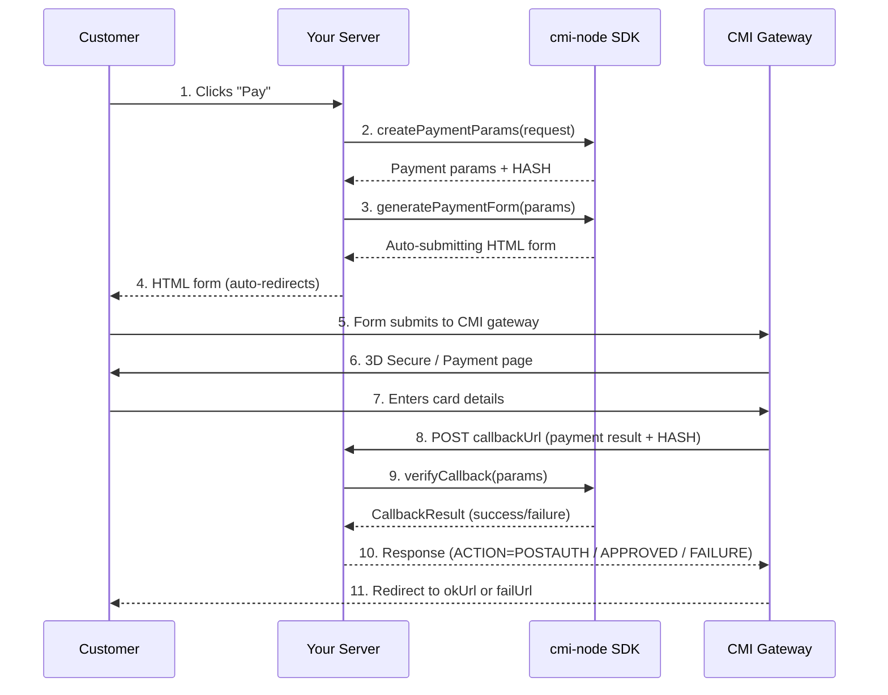

# cmi-node (Node.js Package)

[](https://www.npmjs.com/package/cmi-node)
[](https://opensource.org/licenses/MIT)

**Framework-agnostic CMI Payment Gateway SDK with built-in security for Node.js.**

The `cmi-node` package provides a seamless way to integrate the Centre Monétique Interbancaire (CMI) payment gateway into any Node.js application. It handles parameter building, hash generation, form generation, and callback verification with a focus on security and developer experience.

---

## 🚀 Features

- **Framework Agnostic**: Works with Express, NestJS, Next.js, Fastify, Hono, and more.
- **Type Safe**: Fully written in TypeScript with comprehensive type definitions.
- **Secure by Design**: Built-in hash verification (SHA-512) and timing-safe comparisons.
- **Flexible Callbacks**: Support for both `'auto'` and `'manual'` confirmation modes.
- **Middleware Helpers**: Pre-built helpers for popular frameworks to get you started in minutes.
- **No External Runtime Dependencies**: Uses only Node.js built-ins (`crypto`, `buffer`). Requires Node.js ≥ 18.

---

## 🔄 Payment Flow



> **Note:** Step 8 (callback) only happens if `callbackUrl` is configured. Without it, payment confirmation must be done manually via the CMI Back Office.

---

## 📦 Installation

```bash
# Using npm
npm install cmi-node

# Using yarn (Classic or Berry)
yarn add cmi-node
```

> **Yarn Berry / PnP:** This package has zero runtime dependencies and correct `exports` maps, so it works out of the box with Yarn Berry's Plug'n'Play resolution. No special configuration is needed.

### Subpath Imports (Recommended)

For optimal bundle size, import framework adapters from their dedicated subpath:

```typescript
// Core — always available
import { CMIPaymentGateway } from 'cmi-node';

// Framework adapters — import only what you need
import { createExpressMiddleware } from 'cmi-node/express';
import { createNextJsHandler, handleNextJsCallback } from 'cmi-node/nextjs';
import { createFastifyHandler } from 'cmi-node/fastify';
import { createHonoHandler } from 'cmi-node/hono';
import { NestJSCallbackHandler } from 'cmi-node/nestjs';
```

> **Note:** All adapters are also re-exported from the main `'cmi-node'` entry for convenience, but using subpath imports avoids loading adapters you don't need.

---

## 🛠️ Configuration

```typescript
import { CMIPaymentGateway } from 'cmi-node';

const gateway = new CMIPaymentGateway({
  storeKey: process.env.CMI_STORE_KEY!,    // Your CMI Store Key
  clientId: process.env.CMI_CLIENT_ID!,    // Your CMI Client ID
  gatewayUrl: 'https://testpayment.cmi.co.ma/fim/est3Dgate', // Gateway URL
  storetype: '3d_pay_hosting',
  trantype: 'PreAuth',
  callbackUrl: 'https://api.yoursite.com/payment/callback',
  confirmationMode: 'auto', // Optional: 'auto' | 'manual' (default: 'manual')
});
```

### `PaymentConfig`

| Field | Type | Required | Description |
|---|---|---|---|
| `storeKey` | `string` | ✅ | Secret key provided by CMI for hash generation |
| `clientId` | `string` | ✅ | Numeric Client ID provided by CMI |
| `gatewayUrl` | `string` | ✅ | CMI gateway URL (must use `http://` or `https://`) |
| `storetype` | `string` | ✅ | Store type (`3d_pay_hosting`, `3d`, `pay_hosting`, etc.) |
| `trantype` | `string` | ✅ | Transaction type (case-insensitive: `preauth`, `auth`, `postauth`, `void`, `credit`) |
| `accountType` | `string` | ❌ | Account type: `'inshore'` (default) or `'offshore'`. Offshore requires prior CMI commercial approval. See [Account Types](#-account-types). |
| `callbackUrl` | `string` | ❌ | Callback URL for payment notifications. If omitted, payment confirmation will **not** be triggered automatically — the merchant must confirm manually via the CMI Back Office. |
| `confirmationMode` | `string` | ❌ | `'auto'` (ACTION=POSTAUTH) or `'manual'` (APPROVED). Default: `'manual'`. |

> The SDK strictly validates all configuration fields and rejects unknown or duplicate keys. Only the fields listed above are accepted. Check for typos if you see `"Unknown configuration field detected"`.

---

## 💻 Framework Examples

### 1. Express.js

```typescript
import express from 'express';
import { CMIPaymentGateway, createExpressMiddleware } from 'cmi-node';

const app = express();

// ⚠️ IMPORTANT: body parser MUST be registered before the callback route
app.use(express.json());
app.use(express.urlencoded({ extended: true }));

const gateway = new CMIPaymentGateway({
  storeKey: process.env.CMI_STORE_KEY!,
  clientId: process.env.CMI_CLIENT_ID!,
  gatewayUrl: 'https://testpayment.cmi.co.ma/fim/est3Dgate',
  storetype: '3d_pay_hosting',
  trantype: 'PreAuth',
  callbackUrl: 'https://api.yoursite.com/payment/callback',
  confirmationMode: 'auto',
});

// Initiate a payment — renders an auto-submitting HTML form
app.get('/pay', (req, res) => {
  const params = gateway.createPaymentParams({
    amount: 150.00,
    BillToName: 'Ahmed Bennani',
    email: 'ahmed@example.com',
    tel: '+212600000000',
    okUrl: 'https://yoursite.com/success',
    failUrl: 'https://yoursite.com/failure',
    shopUrl: 'https://yoursite.com',
    currency: '504',   // MAD (required for inshore)
    lang: 'fr',        // 'fr' | 'en' | 'ar'
  });

  const form = gateway.generatePaymentForm(params);
  res.setHeader('Content-Type', 'text/html');
  res.send(form);
});

// Handle CMI callback — SDK verifies hash & sends response automatically
app.post('/payment/callback', createExpressMiddleware(gateway, {
  onSuccess: async (result) => {
    console.log('✅ Payment verified:', result.orderData);
    
    // 1. IMPORTANT: Check idempotency (prevent replay attacks)
    const order = await db.orders.findOne({ id: result.orderData.orderId });
    if (order?.status === 'paid') return; // Already processed!

    // 2. IMPORTANT: Verify the amount matches your database
    if (order.amount !== result.orderData.amount) {
      console.error('Amount mismatch detected!');
      return; 
    }

    // 3. Fulfill the order
    await db.orders.update(result.orderData.orderId, {
      status: 'paid',
      transactionId: result.orderData.transactionId,
    });
  },
  onFailure: (result) => {
    console.error('❌ Payment failed:', result.message, result.errorCode);
  },
}));

app.get('/success', (req, res) => res.send('Payment successful! Thank you.'));
app.get('/failure', (req, res) => res.send('Payment failed. Please try again.'));

app.listen(3000, () => console.log('Server running on http://localhost:3000'));
```

#### Express — Auto-register via Constructor

You can also pass the Express `app` directly to the constructor and it will auto-register the callback route:

```typescript
const app = express();
app.use(express.urlencoded({ extended: true }));

const gateway = new CMIPaymentGateway(
  {
    storeKey: process.env.CMI_STORE_KEY!,
    clientId: process.env.CMI_CLIENT_ID!,
    gatewayUrl: 'https://testpayment.cmi.co.ma/fim/est3Dgate',
    storetype: '3d_pay_hosting',
    trantype: 'PreAuth',
    callbackUrl: 'https://api.yoursite.com/payment/callback',
    confirmationMode: 'auto',
  },
  {
    app,                                      // Express app instance
    callbackPath: '/payment/callback',        // Default: '/api/payment/callback'
    callbackConfig: {
      onSuccess: async (result) => {
        await db.orders.update(result.orderData.orderId, { status: 'paid' });
      },
      onFailure: (result) => {
        console.error('Payment failed:', result.message);
      },
    },
  }
);
```

#### Express — Manual Callback Handler (Custom Response)

Use `createCallbackHandler` when you need full control over the response:

```typescript
import { createCallbackHandler } from 'cmi-node';

app.post('/payment/callback', async (req, res) => {
  const handler = createCallbackHandler(gateway, {
    autoRespond: false, // We'll handle the response manually
    onSuccess: async (result) => {
      await updateOrder(result.orderData.orderId, 'paid');
    },
  });

  const result = await handler.handle(req.body);

  if (result.success) {
    res.status(200).send('ACTION=POSTAUTH');
  } else {
    res.status(200).send('FAILURE');
  }
});
```

---

### 2. NestJS

```typescript
// ──────────────────────────────────────────────
// payment.module.ts
// ──────────────────────────────────────────────
import { Module } from '@nestjs/common';
import { ConfigModule } from '@nestjs/config';
import { PaymentController } from './payment.controller';
import { PaymentService } from './payment.service';

@Module({
  imports: [ConfigModule],
  controllers: [PaymentController],
  providers: [PaymentService],
})
export class PaymentModule {}

// ──────────────────────────────────────────────
// payment.service.ts
// ──────────────────────────────────────────────
import { Injectable } from '@nestjs/common';
import { ConfigService } from '@nestjs/config';
import { CMIPaymentGateway, NestJSCallbackHandler } from 'cmi-node';

@Injectable()
export class PaymentService {
  public readonly gateway: CMIPaymentGateway;
  public readonly callbackHandler: NestJSCallbackHandler;

  constructor(private config: ConfigService) {
    this.gateway = new CMIPaymentGateway({
      storeKey: this.config.getOrThrow('CMI_STORE_KEY'),
      clientId: this.config.getOrThrow('CMI_CLIENT_ID'),
      gatewayUrl: 'https://testpayment.cmi.co.ma/fim/est3Dgate',
      storetype: '3d_pay_hosting',
      trantype: 'PreAuth',
      callbackUrl: this.config.getOrThrow('CMI_CALLBACK_URL'),
      confirmationMode: 'auto',
    });

    this.callbackHandler = new NestJSCallbackHandler(this.gateway, {
      onSuccess: async (result) => {
        console.log('✅ Payment verified:', result.orderData);
        // await this.ordersService.markAsPaid(result.orderData?.orderId);
      },
      onFailure: async (result) => {
        console.error('❌ Payment failed:', result.message);
      },
    });
  }
}

// ──────────────────────────────────────────────
// payment.controller.ts
// ──────────────────────────────────────────────
import { Controller, Get, Post, Query, Body, Res } from '@nestjs/common';
import { Response } from 'express';
import { PaymentService } from './payment.service';

@Controller('payment')
export class PaymentController {
  constructor(private readonly paymentService: PaymentService) {}

  @Get('pay')
  pay(@Query('amount') amount: string, @Res() res: Response) {
    const params = this.paymentService.gateway.createPaymentParams({
      amount: parseFloat(amount) || 100,
      BillToName: 'Ahmed Bennani',
      email: 'ahmed@example.com',
      okUrl: 'https://yoursite.com/success',
      failUrl: 'https://yoursite.com/failure',
      shopUrl: 'https://yoursite.com',
      currency: '504',
      lang: 'fr',
    });

    const form = this.paymentService.gateway.generatePaymentForm(params);
    res.setHeader('Content-Type', 'text/html');
    return res.send(form);
  }

  @Post('callback')
  async handleCallback(@Body() body: any, @Res() res: Response) {
    return this.paymentService.callbackHandler.handle(body, res);
  }
}
```

#### NestJS — Function-style Handler

```typescript
import { createNestJSHandler } from 'cmi-node';

const handleCallback = createNestJSHandler(gateway, {
  onSuccess: async (result) => {
    await updateOrder(result.orderData?.orderId);
  },
});

@Post('callback')
async callback(@Body() body: any, @Res() res: Response) {
  return handleCallback(body, res);
}
```

#### NestJS — Custom Response via `process()`

Use `process()` when you want to inspect the result before sending a response:

```typescript
@Post('callback')
async handleCallback(@Body() body: any): Promise<string> {
  const result = await this.paymentService.callbackHandler.process(body);

  if (result.success) {
    await this.sendNotification(result.orderData);
  }

  return result.success ? result.status : 'FAILURE';
}
```

---

### 3. Next.js — Pages Router

```typescript
// pages/api/payment/callback.ts
import { CMIPaymentGateway, createNextJsHandler } from 'cmi-node';

const gateway = new CMIPaymentGateway({
  storeKey: process.env.CMI_STORE_KEY!,
  clientId: process.env.CMI_CLIENT_ID!,
  gatewayUrl: 'https://testpayment.cmi.co.ma/fim/est3Dgate',
  storetype: '3d_pay_hosting',
  trantype: 'PreAuth',
  callbackUrl: 'https://yoursite.com/api/payment/callback',
  confirmationMode: 'auto',
});

export default createNextJsHandler(gateway, {
  onSuccess: async (result) => {
    console.log('Payment successful:', result.orderData);
    await prisma.order.update({
      where: { id: result.orderData.orderId },
      data: { status: 'PAID' },
    });
  },
  onFailure: async (result) => {
    console.error('Payment failed:', result.message);
  },
});
```

### 3. Next.js — App Router

```typescript
// app/api/payment/callback/route.ts
import { NextRequest } from 'next/server';
import { CMIPaymentGateway, handleNextJsCallback } from 'cmi-node';

const gateway = new CMIPaymentGateway({
  storeKey: process.env.CMI_STORE_KEY!,
  clientId: process.env.CMI_CLIENT_ID!,
  gatewayUrl: 'https://testpayment.cmi.co.ma/fim/est3Dgate',
  storetype: '3d_pay_hosting',
  trantype: 'PreAuth',
  callbackUrl: 'https://yoursite.com/api/payment/callback',
  confirmationMode: 'auto',
});

export async function POST(request: NextRequest) {
  return handleNextJsCallback(gateway, request, {
    onSuccess: async (result) => {
      await updateOrder(result.orderData.orderId, 'paid');
    },
    onFailure: async (result) => {
      console.error('Payment failed:', result.message);
    },
  });
}
```

---

### 4. Fastify

```typescript
import Fastify from 'fastify';
import { CMIPaymentGateway, createFastifyHandler, registerFastifyCallback } from 'cmi-node';

const fastify = Fastify();

const gateway = new CMIPaymentGateway({
  storeKey: process.env.CMI_STORE_KEY!,
  clientId: process.env.CMI_CLIENT_ID!,
  gatewayUrl: 'https://testpayment.cmi.co.ma/fim/est3Dgate',
  storetype: '3d_pay_hosting',
  trantype: 'PreAuth',
  callbackUrl: 'https://yoursite.com/cmi/callback',
  confirmationMode: 'auto',
});

// Initiate payment
fastify.get('/pay', async (request, reply) => {
  const params = gateway.createPaymentParams({
    amount: 200,
    BillToName: 'Youssef Alaoui',
    email: 'youssef@example.com',
    okUrl: 'https://yoursite.com/success',
    failUrl: 'https://yoursite.com/failure',
    shopUrl: 'https://yoursite.com',
    currency: '504',
  });
  return reply.type('text/html').send(gateway.generatePaymentForm(params));
});

// Option A — manual route registration
fastify.post('/cmi/callback', createFastifyHandler(gateway, {
  onSuccess: async (result) => {
    await db.orders.update(result.orderData?.orderId, { status: 'paid' });
  },
  onFailure: (result) => {
    console.error('Payment failed:', result.message);
  },
}));

// Option B — auto-register with registerFastifyCallback
registerFastifyCallback(fastify, gateway, {
  path: '/cmi/callback',
  onSuccess: async (result) => {
    await updateOrder(result.orderData?.orderId);
  },
});

fastify.listen({ port: 3000 });
```

---

### 5. Hono

```typescript
import { Hono } from 'hono';
import { CMIPaymentGateway, createHonoHandler, registerHonoCallback } from 'cmi-node';

const app = new Hono();

const gateway = new CMIPaymentGateway({
  storeKey: process.env.CMI_STORE_KEY!,
  clientId: process.env.CMI_CLIENT_ID!,
  gatewayUrl: 'https://testpayment.cmi.co.ma/fim/est3Dgate',
  storetype: '3d_pay_hosting',
  trantype: 'PreAuth',
  callbackUrl: 'https://yoursite.com/cmi/callback',
  confirmationMode: 'auto',
});

// Initiate payment
app.get('/pay', (c) => {
  const params = gateway.createPaymentParams({
    amount: 300,
    BillToName: 'Fatima Zahra',
    email: 'fatima@example.com',
    okUrl: 'https://yoursite.com/success',
    failUrl: 'https://yoursite.com/failure',
    shopUrl: 'https://yoursite.com',
    currency: '504',
  });
  return c.html(gateway.generatePaymentForm(params));
});

// Option A — manual route registration
app.post('/cmi/callback', createHonoHandler(gateway, {
  onSuccess: async (result) => {
    await db.orders.update(result.orderData?.orderId, { status: 'paid' });
  },
}));

// Option B — auto-register with registerHonoCallback
registerHonoCallback(app, gateway, {
  path: '/cmi/callback',
  onSuccess: async (result) => {
    console.log('Payment successful:', result.orderData);
  },
});

export default app;
```

---

## 📖 API Reference

### `CMIPaymentGateway`

The main class for interacting with the CMI payment gateway.

#### Constructor

```typescript
new CMIPaymentGateway(config: PaymentConfig, options?: {
  app?: any;                   // Express app for auto-registration
  callbackPath?: string;       // Default: '/api/payment/callback'
  callbackConfig?: CallbackHandlerOptions;
})
```

Pass an Express `app` in the second argument to auto-register the callback endpoint. For all other frameworks, use the dedicated helpers.

---

### `gateway.createPaymentParams(request)`

Creates payment parameters for initiating a payment. Returns a `Record<string, any>` ready to pass to `generatePaymentForm()`.

#### `PaymentRequest`

| Field | Type | Required | Max Length | Description |
|---|---|---|---|---|
| `amount` | `number \| string` | ✅ | — | Payment amount (≥ 1, formatted to 2 decimal places) |
| `email` | `string` | ✅ | 64 | Customer email address |
| `BillToName` | `string` | ✅ | 255 | Customer billing name (alphanumeric + spaces) |
| `okUrl` | `string` | ✅ | — | Redirect URL on success (must use `http(s)://`) |
| `failUrl` | `string` | ✅ | — | Redirect URL on failure (must use `http(s)://`) |
| `shopUrl` | `string` | ✅ | — | Your shop URL (must use `http(s)://`) |
| `currency` | `string` | ✅ | — | Currency code or numeric. Inshore: must be `"504"` or `"MAD"`. Offshore: any supported currency. |
| `oid` | `string` | ❌ | 64 | Order ID (auto-generated if omitted) |
| `rnd` | `string` | ❌ | 20 | Random value (auto-generated if omitted, must be alphabetic) |
| `lang` | `string` | ❌ | — | Language code: `"fr"`, `"en"`, `"ar"`, etc. (default: `"fr"`) |
| `tel` | `string` | ❌ | 32 | Customer phone number |
| `description` | `string` | ❌ | 125 | Payment description |
| `AutoRedirect` | `boolean` | ❌ | — | Auto-redirect after payment (default: `false`) |
| `hashAlgorithm` | `string` | ❌ | — | Must be `"ver3"` if provided |
| `encoding` | `string` | ❌ | — | Must be `"UTF-8"` if provided (default: `"UTF-8"`) |
| `amountCur` | `number` | ❌ | — | Display amount in foreign currency (requires `symbolCur`; inshore only) |
| `symbolCur` | `string` | ❌ | — | Foreign currency code, e.g. `"840"` for USD (requires `amountCur`; inshore only) |
| `sessiontimeout` | `number` | ❌ | — | CMI hosted page session timeout in seconds. Min: 30, Max: 2700, Default: 1800. |
| `redirectGet` | `boolean` | ❌ | — | When `true`, CMI redirects the customer to `okUrl`/`failUrl` via GET instead of POST. |
| `CallbackResponse` | `boolean` | ❌ | — | Enables or disables the server-to-server callback for this specific request. Default: `true`. |
| `BillToCompany` | `string` | ❌ | 255 | Billing company name |
| `BillToStreet1` | `string` | ❌ | 255 | Billing street address line 1 |
| `BillToStreet2` | `string` | ❌ | 255 | Billing street address line 2 |
| `BillToStreet3` | `string` | ❌ | 255 | Billing street address line 3 |
| `BillToCity` | `string` | ❌ | 64 | Billing city |
| `BillToStateProv` | `string` | ❌ | 32 | Billing state/province |
| `BillToPostalCode` | `string` | ❌ | 32 | Billing postal code |
| `BillToCountry` | `string` | ❌ | 3 | Billing country code |
| `BillToTelVoice` | `string` | ❌ | — | Billing telephone (voice) |

> **Custom fields:** Any field not listed above is passed through to the gateway as-is. Field names are case-insensitive — `shopUrl`, `SHOPURL`, and `shopurl` all resolve to the same field.

#### Item-Level Fields

CMI supports per-item order details using numbered field names. Pass them as additional properties on the request:

```typescript
gateway.createPaymentParams({
  amount: 29.98,
  currency: '504',
  // ...other required fields
  id1: 'ITEM-001',
  itemnumber1: '1',
  productcode1: 'BOOK',
  qty1: 2,
  desc1: 'Node.js Book',
  price1: 14.99,
  total1: 29.98,
});
```

---

### `gateway.generatePaymentForm(params, options?)`

Generates a fully styled, auto-submitting HTML page that redirects the customer to the CMI gateway. The page includes a loading overlay with a spinner and "Secured by CMI" badge displayed during the redirect.

```typescript
const form = gateway.generatePaymentForm(params);
res.setHeader('Content-Type', 'text/html');
res.send(form);
```

**Options:**

| Field | Type | Description |
|---|---|---|
| `nonce` | `string` | CSP nonce applied to inline `<style>` and `<script>` tags |

#### CSP — Using `generateInputs()`

If your app enforces a strict Content-Security-Policy that blocks `'unsafe-inline'`, use `generateInputs()` to get raw hidden inputs and build your own form:

```typescript
// gateway.generateInputs() is exposed via the internal FormGenerator
// Use it when you need custom form submission logic

const inputs = gateway.generatePaymentForm(params); // or use gateway directly:

// Alternatively, build your own form manually:
const form = gateway.generatePaymentForm(params, { nonce: 'your-csp-nonce' });
res.send(form);
```

For full CSP control, use the `CallbackHandler` directly and build your own HTML form with the hidden inputs returned via `generatePaymentForm`:

```typescript
// Pass your nonce to avoid 'unsafe-inline'
const form = gateway.generatePaymentForm(params, { nonce: req.cspNonce });
res.send(form);
```

---

### `gateway.verifyCallback(callbackParams)`

Verifies a raw callback from the CMI gateway using a timing-safe SHA-512 hash comparison.

```typescript
const result = gateway.verifyCallback(req.body);
if (result.success) {
  // Payment is authentic — safe to update your database
}
```

#### `CallbackResult`

```typescript
interface CallbackResult {
  success: boolean;
  status: 'ACTION=POSTAUTH' | 'APPROVED' | 'FAILURE';
  message: string;
  orderData?: {
    // ── Core fields ───────────────────────────────────────────────
    orderId: string | undefined;
    amount: number;
    currency: string;
    /** Bank transaction ID. From TransId. Undefined on failure callbacks. */
    transactionId?: string;

    // ── Always present (success + failure) ───────────────────────
    /** Bank/gateway return code. '00' = success. From ProcReturnCode. */
    returnCode?: string;
    /** Human-readable label, e.g. "Approved", "Error", "Declined". From Response. */
    response?: string;
    /** 3D-Secure authentication status. 1 = full 3D, 0 = failed. From mdStatus. */
    mdStatus?: string;
    /** Error description. From ErrMsg. */
    errorMessage?: string;
    /** Error code, e.g. "CORE-5110". From ErrCode. */
    errorCode?: string;
    /** Order ID echoed back by CMI. From ReturnOid. */
    returnOid?: string;
    /** Cardholder IP address. From ClientIp. */
    clientIp?: string;

    // ── Present on success ─────────────────────────────────────────
    /** Bank authorisation code. From AuthCode. */
    authCode?: string;
    /** Transaction date/time as ddmmyyyy hhmmss. From EXTRA.TRXDATE. */
    transactionDate?: string;
    /** Masked card number, e.g. "400000XXXXXX7190". From MaskedPan. */
    maskedPan?: string;
    /** Cardholder full name. From cardHolderName. */
    cardHolderName?: string;
    /** Payment method type, e.g. "CARD". From paymentType. */
    paymentType?: string;
    /** Card scheme, e.g. "VISA", "MASTERCARD". From EXTRA.CARDBRAND. */
    cardBrand?: string;
    /** Card-issuing bank name. From EXTRA.CARDISSUER. */
    cardIssuer?: string;
    /** Card expiry year. From EcomPaymentCardExpDateYear. */
    cardExpYear?: string;
    /** Card expiry month. From EcomPaymentCardExpDateMonth. */
    cardExpMonth?: string;
    /** Host reference number assigned by acquirer. From HostRefNum. */
    hostRefNum?: string;
    /** Acquirer STAN (System Trace Audit Number). From acqStan. */
    acqStan?: string;
    /** Electronic Commerce Indicator. From eci. */
    eci?: string;
    /** 3D archival status: Y / N / A. From txstatus. */
    txStatus?: string;
  };
  errorCode?: string;
  errorMessage?: string;
}
```

---

### `gateway.getConfirmationMode()`

Returns the current confirmation mode (`'auto'` or `'manual'`).

### `gateway.getConfig()`

Returns the gateway configuration **without** the `storeKey` (sanitized for safety).

---

### `CallbackHandler`

The low-level handler class used internally by all framework helpers. Use it when you need fine-grained control over callback processing.

```typescript
import { CallbackHandler } from 'cmi-node';

const handler = new CallbackHandler(gateway, {
  autoRespond: false,
  onSuccess: async (result) => { /* ... */ },
  onFailure: async (result) => { /* ... */ },
});

// In your route:
const result = await handler.handle(req.body);
const response = handler.getResponse(result);
res.status(response.status).send(response.body);
```

#### `CallbackHandlerOptions`

| Field | Type | Default | Description |
|---|---|---|---|
| `onSuccess` | `(result: CallbackResult) => void \| Promise<void>` | — | Called when payment is verified successfully |
| `onFailure` | `(result: CallbackResult) => void \| Promise<void>` | — | Called when payment verification fails |
| `autoRespond` | `boolean` | `true` | Automatically send the appropriate response string to CMI |
| `successResponse` | `string` | `"ACTION=POSTAUTH"` or `"APPROVED"` | Custom success response message |
| `failureResponse` | `string` | `"FAILURE"` | Custom failure response message |
| `supportGetMethod` | `boolean` | `false` | Accept callback params from GET query strings ⚠️ |

> ⚠️ **Security Warning:** Enabling `supportGetMethod` causes callback parameters (including `HASH` and payment data) to be read from query strings. Query strings are logged in server access logs, browser history, proxy caches, and CDN logs. Only enable this if your gateway explicitly requires it and your infrastructure does not log query parameters.

---

### `NestJSCallbackHandler`

A class-based wrapper for NestJS that wraps `CallbackHandler` for use with the DI system.

| Method | Signature | Description |
|---|---|---|
| `handle(body, res)` | `(body: any, res: any) => Promise<any>` | Handles the callback and writes the CMI response to `res` |
| `process(body)` | `(body: any) => Promise<CallbackResult>` | Handles the callback and returns the `CallbackResult` without writing to `res` |
| `getResponseString(result)` | `(result: CallbackResult) => string` | Returns the appropriate CMI response string (`ACTION=POSTAUTH`, `APPROVED`, or `FAILURE`) |

---

## 📋 Logger Configuration

The SDK includes an environment-aware logger. In production (`NODE_ENV=production`), only errors are logged. In development, all levels are shown.

```typescript
import { configureLogger, resetLogger } from 'cmi-node';

// Set log level
configureLogger({ level: 'error' }); // 'debug' | 'info' | 'warn' | 'error'

// Disable all logging
configureLogger({ enabled: false });

// Customize prefix
configureLogger({ prefix: '[MyApp Payment]' });

// Reset to defaults
resetLogger();
```

---

## 🔒 Security

This SDK implements the **SHA-512** hashing algorithm required by CMI.

- **Outgoing**: Parameters are automatically sorted and hashed before being sent to CMI.
- **Incoming**: Callbacks are verified by recalculating the hash from the received parameters and performing a **timing-safe comparison** to prevent timing attacks.
- **storeKey isolation**: The store key is wrapped in an internal `SecretString` and never stored in plain form on the config object. `gateway.getConfig()` always returns a sanitized copy without the key.

```typescript
// Manual verification if not using middleware
const result = gateway.verifyCallback(req.body);
if (result.success) {
  // Trust the data!
}
```

---

## 🛡️ Security Best Practices

### 1. Idempotency & Replay Protection

The CMI callback mechanism verifies that the data is authentic, but it does **not** prevent the same callback from being sent twice (replay attack).

- In your `onSuccess` handler, you **must** check your database to see if the order has already been marked as paid before acting on the result.

```typescript
onSuccess: async (result) => {
  const order = await db.orders.find(result.orderData.orderId);
  if (order.status === 'paid') return; // Already processed
  await db.orders.update(order.id, { status: 'paid' });
}
```

### 2. Content Security Policy (CSP)

If your application enforces a strict CSP that blocks `'unsafe-inline'` scripts, pass a nonce to `generatePaymentForm()`:

```typescript
const form = gateway.generatePaymentForm(params, { nonce: 'your-csp-nonce' });
```

### 3. Rate Limiting

Always implement rate limiting on your callback endpoint to prevent brute-force or Denial-of-Service (DoS) attacks.

---

## 🏦 Account Types

The SDK supports two account types that affect currency and multi-currency behavior:

| Account Type | Currency | `amountCur` / `symbolCur` | Description |
|---|---|---|---|
| `'inshore'` (default) | MAD only (`"504"` or `"MAD"`) | ✅ Allowed | Standard Moroccan merchant account. Use `amountCur`/`symbolCur` to display a foreign currency equivalent. |
| `'offshore'` | Any supported currency | ❌ Not allowed | Offshore merchant account that processes in a foreign currency directly. |

> ⚠️ **Important:** The `'offshore'` account type is **not enabled by default**. To use offshore processing, you must contact the CMI commercial department and request activation.

```typescript
// Inshore (default) — process in MAD, display in EUR
const gateway = new CMIPaymentGateway({
  // accountType: 'inshore' — this is the default, no need to set it
  ...config,
});

gateway.createPaymentParams({
  amount: 100,       // Amount in MAD
  currency: '504',   // Always MAD for inshore
  amountCur: 10,     // Display amount in foreign currency
  symbolCur: '978',  // EUR
  // ...
});

// Offshore — process directly in USD (requires CMI commercial approval)
const offshoreGateway = new CMIPaymentGateway({
  ...config,
  accountType: 'offshore',
});

offshoreGateway.createPaymentParams({
  amount: 50,
  currency: 'USD',  // Any supported currency
  // amountCur / symbolCur are NOT allowed for offshore
  // ...
});
```

### Callback URL Behavior

The `callbackUrl` field is **optional** in the gateway configuration:

- **With `callbackUrl`**: CMI sends a server-to-server POST to your endpoint after the payment. The SDK verifies the hash and triggers your `onSuccess`/`onFailure` handlers automatically.
- **Without `callbackUrl`**: The payment still processes, but **no automatic confirmation is sent**. The merchant must manually confirm or void the transaction via the **CMI Back Office**.

---

## ❓ Troubleshooting

### Hash Mismatch on Callback

**Symptom:** `verifyCallback()` returns `{ success: false, message: 'Hash verification failed' }`

**Common causes:**

1. **Wrong `storeKey`** — Ensure you're using the exact key provided by CMI (test vs. production).
2. **Body parser not configured** — `req.body` must be parsed before reaching the callback handler:
   ```typescript
   // Express: add BEFORE callback route
   app.use(express.urlencoded({ extended: true }));
   ```
3. **Case-sensitive field names** — The SDK normalizes field casing automatically, but if you're manually constructing params, be consistent.

### "Amount must be greater than or equal to 1"

The CMI gateway requires `amount >= 1`. For sub-unit pricing, multiply to reach the minimum.

### "Inshore accounts only accept MAD"

For **inshore** accounts (default), the `currency` field must be `"504"` (numeric) or `"MAD"`. For foreign currency display, use `amountCur` and `symbolCur`:

```typescript
gateway.createPaymentParams({
  amount: 100,
  currency: '504',   // Always MAD for inshore
  amountCur: 10,     // Display amount in foreign currency
  symbolCur: '840',  // USD
});
```

For **offshore** accounts, you can use any supported currency directly:

```typescript
const gateway = new CMIPaymentGateway({ ...config, accountType: 'offshore' });
gateway.createPaymentParams({
  amount: 50,
  currency: 'USD',
  // amountCur / symbolCur NOT allowed for offshore
});
```

### Callback URL Not Reachable in Development

CMI sends callbacks to `callbackUrl` from their servers. `localhost` URLs won't work. Use a tunnel like [ngrok](https://ngrok.com/) for local development:

```bash
ngrok http 3000
# Use the https://*.ngrok.io URL as your callbackUrl
```

### "Unknown configuration field detected"

The SDK strictly validates configuration fields. Only these fields are accepted:
`storeKey`, `clientId`, `gatewayUrl`, `storetype`, `trantype`, `accountType`, `callbackUrl`, `confirmationMode`.

Check for typos or extra fields in your config object.

---

## 🧪 Development

```bash
# Install dependencies
npm install

# Build the project (CJS, ESM, Types)
npm run build

# Run tests
npm test

# Run tests with coverage
npm run test:coverage

# Linting
npm run lint

# Format code
npm run format
```

---

## 🤝 Contributing

Contributions are welcome! Please read the [CONTRIBUTING.md](./CONTRIBUTING.md) before submitting a pull request.

**Quick rules:**

- **Commit messages** must follow [Conventional Commits](https://www.conventionalcommits.org/):
  ```
  feat: add offline mode support
  fix(core): resolve hash mismatch on callback
  ```
  Allowed types: `feat`, `fix`, `docs`, `refactor`, `test`, `chore`, `ci`

- **Branch names** must follow `<type>/<short-description>`:
  ```
  feature/add-refund
  fix/callback-bug
  ```
  Allowed types: `feature`, `fix`, `chore`, `docs`, `refactor`, `release`, `ci`, `test`

- All commits, pushes, and PRs are validated automatically via Git hooks and CI.

---

## 📄 License

MIT © [Ishak Zail](mailto:ishak.zail.iz@gmail.com)
